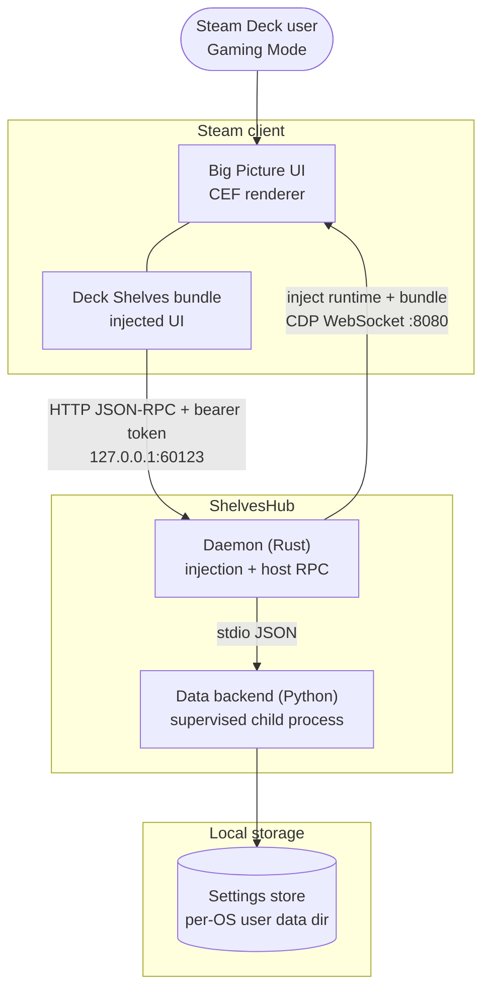
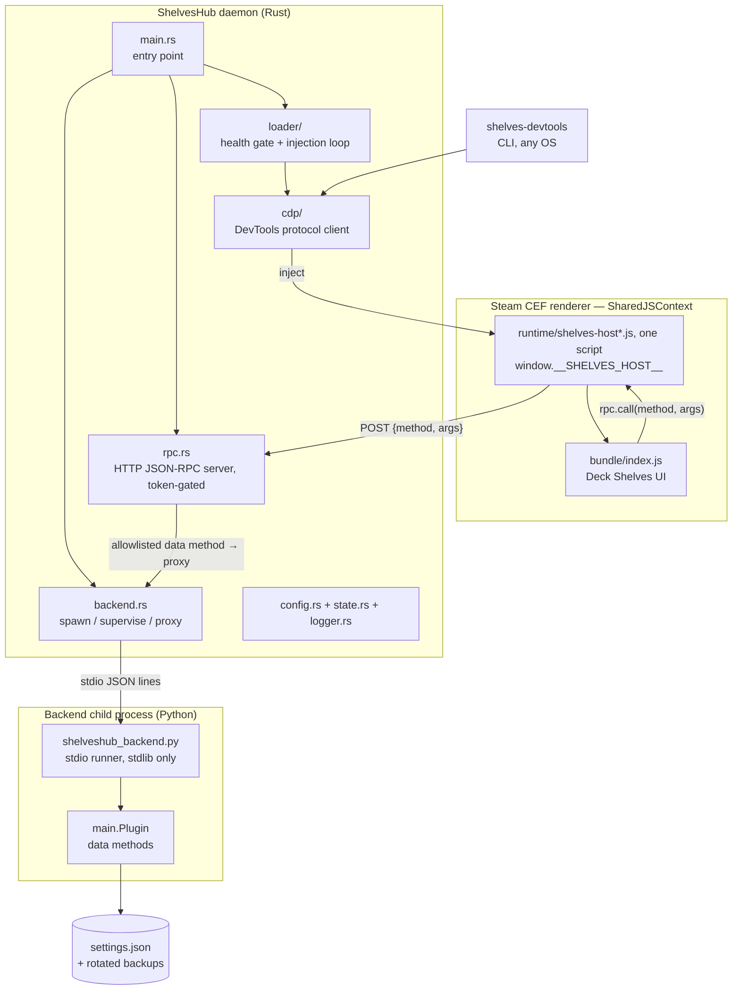
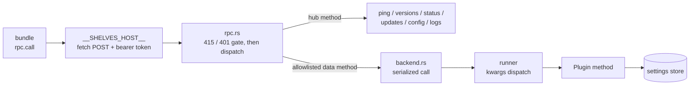

# ShelvesHub — Architecture

*[Leia em português](pt-BR/architecture.md)*

ShelvesHub is a small cross-platform service that injects the Deck Shelves
bundle into the Steam Big Picture UI. It provides the runtime host APIs the
bundle calls into, and manages the injection lifecycle across Linux/SteamOS,
macOS, and Windows.

---

## System overview

### The service in its environment

### Runtime pieces

### Data request path

The bundle receives the `HostApi` object as `window.__SHELVES_HOST__` at
startup. It uses that object to register mount/unmount hooks, invoke host
methods, and manage routes. UI components and all rendering logic live entirely
inside the bundle. Data methods flow through one serialized pipeline — a single
in-flight backend call at a time — so writes never race inside this host.

---

## Components

### Loader (`src/loader/`)

Every tick (default 30s) it reads the renderer's target list over the Chrome
DevTools Protocol as a health gate — the visible Steam UI lives in windows that
are separate targets from `SharedJSContext`, so a lone `SharedJSContext` means
the UI collapsed and the loop pauses injection (and runs the per-platform
recovery once) instead of injecting into it. On a healthy renderer it probes
whether the bundle is already running (`window.__SHELVES_LOADER__`) and — if
not — stamps `window.__SHELVES_CONFIG__` (RPC endpoint and token, contract
version, device), injects the host runtime (the `runtime/shelves-host*.js` parts
assembled into one script, which becomes `window.__SHELVES_HOST__`) and then
`bundle/index.js` via `Runtime.evaluate`. The connection is rebuilt each tick,
so a Steam restart is re-injected automatically. Paths and the CEF endpoint are
configurable (`src/config.rs`).

Before injecting, the loop honours the renderer's single-owner claim
(`window.__DECK_SHELVES_OWNER__`) and probes for a plugin loader: if another
host owns the renderer, the tick never hosts the plugin bundle itself. With the
native Quick Access tab enabled (`native_qam`, on in the shipped config;
`SHELVES_NATIVE_QAM=1` per service) it still injects its runtime, which detects
the other host and adds ShelvesHub's tab alongside without publishing its own
host — so both tabs coexist and the other host's plugin is left untouched; with
the tab off the tick stands down entirely. `force_owner`
(`SHELVES_FORCE_OWNER=shelveshub`) is cooperative ownership: next to a loader
the daemon stamps `window.__SHELVES_FORCE_OWNER__` and injects a runtime that
does publish `window.__SHELVES_HOST__`, so the loader's Deck Shelves binds to
ShelvesHub while the loader keeps the renderer and its other plugins; the bundle
is still not injected (the loader provides it, unless `coop_bundle` is on). It
never evicts a host that already owns the renderer — two hosts doing a full
injection into one renderer is unstable. Without a loader on the machine, force
only delays the first injection: the loop waits at least 20 s (or
`owner_settle_secs`, whichever is longer) for a loader's globals to appear and
then hosts as a sole host anyway, with the forced stamp set — so a machine where
ShelvesHub is the only host keeps `force_owner` off.

While the renderer is still unclaimed, `SHELVES_OWNER_SETTLE_SECS` (config key
`owner_settle_secs`) makes the loop wait that many seconds for a claim to appear
before hosting the renderer itself — so on a shared machine a fast injection cycle
never starts hosting ahead of another host that is still starting up. The code
default is `0`; the shipped `shelveshub.config.json` sets **25** for the primary
(coexistence) setup. A sole host sets it back to `0` to boot immediately.

### CDP client (`src/cdp/`)

A from-scratch Chrome DevTools Protocol client over a blocking WebSocket
(`tungstenite`). Discovers targets via `GET /json`, picks the Steam renderer,
and exposes `evaluate` / `call` / target discovery. Shared by the loader loop
and the `shelves-devtools` CLI. See [debugging.md](./debugging.md).

### RPC server (`src/rpc.rs`)

Minimal blocking HTTP/1.1 server on `127.0.0.1:60123` (configurable). The daemon
binds it before anything else and exits when it cannot (usually because another ShelvesHub, or
another process, holds the port), so a second daemon never injects nor replaces the running
one's token. The bundle
reaches it with a `fetch` POST of `{ method, args }` from inside the renderer, so
it emits CORS headers and handles preflight. Every request must carry
`Content-Type: application/json` (anything else answers 415) and
`Authorization: Bearer <token>` — a per-boot token the daemon stamps into the
runtime (`window.__SHELVES_CONFIG__.rpcToken`) over its private CDP channel and
writes, mode 0600, to `.rpc-token` in its per-user install directory for
same-user tools such as the tray; a missing or wrong token answers 401 before
any dispatch. Methods, by group:

| Group | Methods |
|---|---|
| Health and handshake | `ping`, `getVersion`, `getHostApiVersion`, `isInjected`, `getDiagnostics` |
| Hosted backend | `getBackendStatus`, `restartBackend`, and the plugin backend's public API names (the `BACKEND_METHODS` allowlist, 35 names) |
| Plugin bundle | `populateBundle`, `applyUpdate` (URL-pinned to the Deck Shelves releases), `rollbackBundle` |
| Hub binary | `checkUpdates`, `selfUpdate`, `rollbackHub`, `restartService` |
| Hub settings store | `getConfig`, `setAutoUpdate`, `setUpdatePref`, `setConfigSync` |
| Operational config | `getRuntimeConfig`, `setRuntimeConfig` (a fixed set of editable keys; `recover_cmd` is never settable over RPC), `setBootMovie`, `setHostingPaused` |
| Logs | `getLogs`, `clearLogs`, `pushLogs` |

Only the allowlisted backend names are proxied to the hosted backend (below),
and only while backend hosting is configured; anything else answers an
`unknown method` error. The manual bundle and hub actions (`populateBundle`,
`applyUpdate`, `rollbackBundle`, `rollbackHub`, `selfUpdate`) share the loop's
single-flight update guard and answer `busy` while a check runs; `selfUpdate`
reports `current` when nothing newer is published or `staged` when that release
already waits for a restart, and `rollbackHub` is refused while a hub binary is
staged. Each connection is served on its own thread (at
most 64 at once, 503 beyond; request lines and headers capped at 8 KiB and 64
headers, 400 beyond) so a slow data call never delays probes, and the log keeps
only the method name of a request, never its body. See
[host-api.md](./host-api.md#rpc-wire-format) for the wire format and a `curl`
recipe.

### Backend host (`src/backend.rs` + `runtime/backend/`)

Hosts the Deck Shelves Python data backend as a supervised child process: the
one in `SHELVES_BACKEND_DIR`, else the copy in its install folder (`backend/`),
which the daemon obtains on a first start (from a loader-managed Deck Shelves,
else the release download) and, after every Deck Shelves update, brings to that
same release and restarts — a directory set with `SHELVES_BACKEND_DIR` is never
replaced. Without either, the data methods stay off and local shelves still
work. The daemon spawns
`runtime/backend/shelveshub_backend.py` (standard library only), which loads
the backend's `Plugin` class and serves its public methods over
line-delimited JSON on stdio — an object argument is applied as keyword
arguments, an array as positional, names starting with `_` are rejected on
both sides. The child's stderr streams into the daemon log; a crash is
respawned after a cooldown, and a hung call is killed and restarted. The
backend receives its settings directory via `DECK_SHELVES_SETTINGS_DIR`
(per-OS user data dir by default, `SHELVES_SETTINGS_DIR` to override) — a
neutral location independent of any other tool's file tree. A minimal
example backend lives in `examples/backend/`.

### Logger (`src/logger.rs`)

Structured log lines: `[LEVEL] [timestamp] [subsystem] message`. Levels: INFO,
WARN, ERROR. Used by all Rust modules; the host runtime's own lines reach the
same ring over the `pushLogs` request.

### Runtime — HostApi

The injected host runtime is `runtime/shelves-host.js` plus its `-qam.js`,
`-api.js`, `-sidecar.js` and `-toast.js` parts — the daemon assembles them into
one self-contained script and evaluates it in the renderer. It installs
`window.__SHELVES_HOST__` (the concrete `HostApi`) and the native Quick Access
tab, and delegates RPC to the Rust server. The contract it implements is the
shared `@deck-shelves/host` package (`HOST_API_VERSION = "1.5.0"`, additive-only
after the 1.0 baseline); its typed source is vendored as the `host/` submodule
(`host/src/contract/index.ts`), and the daemon derives the version from it at
build time.

See [docs/host-api.md](./host-api.md) for the full contract reference.

### Bundle (`bundle/index.js`)

Placeholder. In production this is the built Deck Shelves bundle — placed here
by the Deck Shelves release pipeline. The loader reads it from
`SHELVES_BUNDLE_PATH` (default: next to the binary); the bundle content is owned
by the Deck Shelves repository. A working stand-in for local testing lives in
`examples/bundle/shelves-example.js` (see [debugging.md](./debugging.md)).

### Host runtime (`runtime/shelves-host*.js`)

The executed implementation of the HostApi contract. The loader injects it into
the renderer before the bundle, where it becomes `window.__SHELVES_HOST__`:
`lifecycle`, `rpc` (HTTP), `ui` (Steam's own components), `routes`,
`notifications`, `platform`, `qam`, `updates` and `handshake()`. It includes a
from-scratch Steam webpack module-finder and, in `shelves-host-qam.js`, the
native Quick Access tab: a first-class tab in Steam's own strip that shows the
registered Deck Shelves panel (the editor) or, when none is registered, the
hub's own view (status, updates, configuration, logs); `shelves-host-sidecar.js`
widens the menu for the log and notification side panel, and
`shelves-host-toast.js` carries notices through Steam's toast pipeline. Written
from scratch — no third-party loader source is copied. Shipped alongside the
binary (`runtime/` next to `shelveshub`).

### Developer tool (`src/bin/devtools.rs`)

`shelves-devtools` — a cross-platform CDP CLI (`targets` / `probe` / `eval` /
`inject` / `reload` / `console` / `preload`) for inspecting and debugging the
renderer from Linux, macOS or Windows, locally or against a Deck over an SSH
tunnel.

---

## Cross-platform service management

| Platform | Mechanism | Unit file |
|---|---|---|
| Linux / SteamOS | systemd | `installer/Linux/shelveshub.service` |
| macOS | launchd | `installer/macOS/com.shelveshub.plist` |
| Windows | Task Scheduler | `installer/Windows/install.ps1` |

All three start the compiled `shelveshub` binary, restart on failure, and run
as the current user so they share the Steam session.

---

## Pending work (ShelvesHub mode)

All of the original host-API surface is implemented as `window.__SHELVES_HOST__`
(the `host` object built in `runtime/shelves-host-api.js`, assembled with the
other runtime parts into the one script the daemon injects); this checklist is
complete.

- [x] Replace the `is_injected()` placeholder with a real CEF probe
- [x] Replace the shell-call injection with the WebSocket/CDP injection
      mechanism into the Steam renderer
- [x] Implement `__SHELVES_HOST__.lifecycle.*` (`register` / `onMount` / `onUnmount`)
- [x] Implement `__SHELVES_HOST__.routes.*` (Steam-side route registration via the
      concrete `routerHook` — `addRoute` / `removeRoute` / `addPatch`)
- [x] Implement `__SHELVES_HOST__.notifications.*` (`toast` / `send`)
- [x] Implement `__SHELVES_HOST__.platform.navigateToApp` (`SteamClient.Apps.RunGame`)
