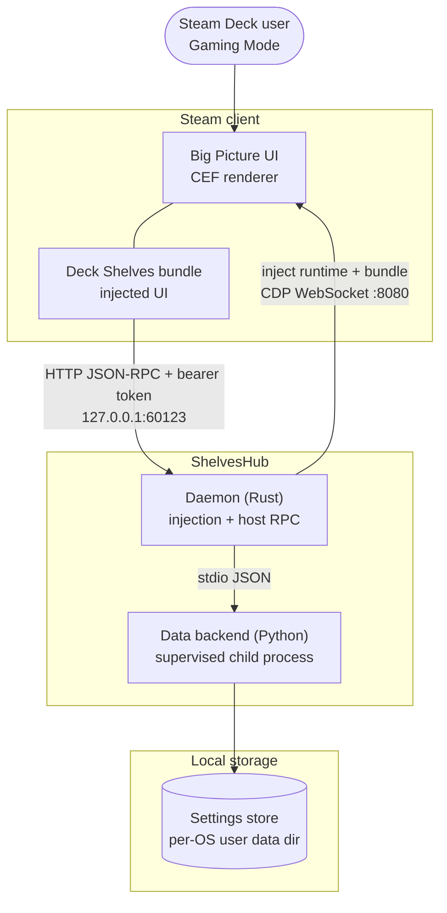
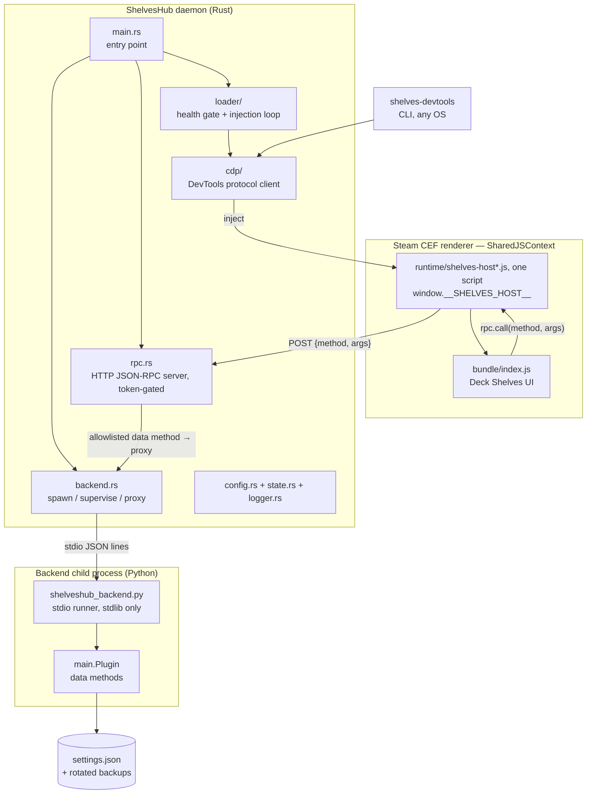
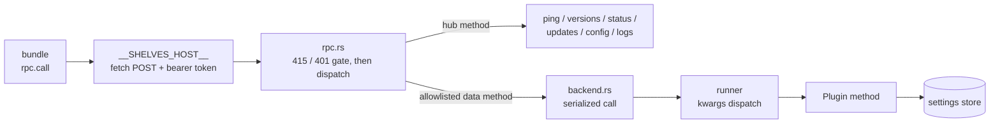

# ShelvesHub — Arquitetura

*[Read in English](../architecture.md)*

ShelvesHub é um pequeno serviço multiplataforma que injeta o pacote do Deck Shelves
na interface Big Picture do Steam. Ele fornece as APIs de runtime do host que o
pacote chama, e gerencia o ciclo de vida da injeção no Linux/SteamOS, no
macOS e no Windows.

---

## Visão geral do sistema

### O serviço em seu ambiente

### Peças do runtime

### Caminho de uma requisição de dados

O pacote recebe o objeto `HostApi` como `window.__SHELVES_HOST__` na
inicialização. Ele usa esse objeto para registrar hooks de montagem/desmontagem, invocar
métodos do host, e gerenciar rotas. Os componentes de interface e toda a lógica de renderização vivem inteiramente
dentro do pacote. Os métodos de dados fluem por um único pipeline serializado — uma única
chamada ao backend em andamento por vez — então as gravações nunca competem dentro deste host.

---

## Componentes

### Loader (`src/loader/`)

A cada ciclo (30s por padrão) ele lê a lista de alvos do renderizador via o Chrome
DevTools Protocol como um portão de saúde — a interface visível do Steam vive em janelas
que são alvos separados do `SharedJSContext`, então um `SharedJSContext` sozinho
significa que a interface colapsou e o loop pausa a injeção (e roda a recuperação
por plataforma uma vez) em vez de injetar nela. Num renderizador saudável ele verifica
se o pacote já está rodando (`window.__SHELVES_LOADER__`) e — se não estiver — grava
`window.__SHELVES_CONFIG__` (endpoint e token do RPC, versão do contrato, dispositivo),
injeta o runtime do host (as partes `runtime/shelves-host*.js` montadas em um único
script, que se torna `window.__SHELVES_HOST__`) e depois `bundle/index.js` via
`Runtime.evaluate`. A conexão é reconstruída a cada ciclo, então um reinício do Steam
é reinjetado automaticamente. Os caminhos e o endpoint CEF são configuráveis
(`src/config.rs`).

Antes de injetar, o loop respeita a reivindicação de proprietário único do renderizador
(`window.__DECK_SHELVES_OWNER__`) e procura um carregador de plugins: se outro host
possui o renderizador, o ciclo nunca hospeda o pacote do plugin ele mesmo. Com a aba
nativa de Acesso Rápido habilitada (`native_qam`, ligada na configuração distribuída;
`SHELVES_NATIVE_QAM=1` por serviço) ele ainda injeta apenas seu runtime, que detecta o
outro host e adiciona a aba do ShelvesHub ao lado sem publicar seu próprio host — então
ambas as abas coexistem e o plugin do outro host permanece intocado; com a aba
desligada o ciclo recua completamente. `force_owner`
(`SHELVES_FORCE_OWNER=shelveshub`) é a posse cooperativa: ao lado de um carregador o
daemon grava `window.__SHELVES_FORCE_OWNER__` e injeta um runtime que publica, sim,
`window.__SHELVES_HOST__`, para que o Deck Shelves do carregador se vincule ao
ShelvesHub enquanto o carregador mantém o renderizador e seus outros plugins; o pacote
continua não sendo injetado (o carregador o fornece, a menos que `coop_bundle` esteja
ligado). Ele nunca expulsa um host que já possui o renderizador — dois hosts fazendo
uma injeção completa no mesmo renderizador é instável. Sem nenhum carregador na máquina,
a posse forçada só atrasa a primeira injeção: o loop espera pelo menos 20 s (ou
`owner_settle_secs`, o que for maior) pelos globais de um carregador e então hospeda
como host único mesmo assim, com a marca de força gravada — então uma máquina em que o
ShelvesHub é o único host mantém `force_owner` desligado.

Enquanto o renderizador ainda estiver sem dono, `SHELVES_OWNER_SETTLE_SECS` (chave de configuração
`owner_settle_secs`) faz o loop esperar esse número de segundos por uma reivindicação antes
de hospedar o renderizador ele mesmo — então, em uma máquina compartilhada, um ciclo de injeção rápido
nunca começa a hospedar antes de outro host que ainda está iniciando. O padrão no código
é `0`; o `shelveshub.config.json` distribuído define **25** para a configuração primária
(de coexistência). Um host único o define de volta para `0` para inicializar imediatamente.

### Cliente CDP (`src/cdp/`)

Um cliente do Chrome DevTools Protocol feito do zero sobre um WebSocket bloqueante
(`tungstenite`). Descobre alvos via `GET /json`, escolhe o renderizador do Steam,
e expõe `evaluate` / `call` / descoberta de alvos. Compartilhado pelo loop do loader
e pela CLI `shelves-devtools`. Veja [debugging.md](./debugging.md).

### Servidor RPC (`src/rpc.rs`)

Servidor HTTP/1.1 bloqueante e minimalista em `127.0.0.1:60123` (configurável). O pacote
o alcança com um `fetch` POST de `{ method, args }` de dentro do renderizador, então
ele emite cabeçalhos CORS e trata preflight. Toda requisição precisa levar
`Content-Type: application/json` (qualquer outra coisa responde 415) e
`Authorization: Bearer <token>` — um token por inicialização que o daemon grava no
runtime (`window.__SHELVES_CONFIG__.rpcToken`) pelo seu canal CDP privado e escreve,
com modo 0600, em `.rpc-token` no seu diretório de instalação por usuário para
ferramentas do mesmo usuário, como a bandeja; um token ausente ou errado responde 401
antes de qualquer despacho. Métodos, por grupo:

| Grupo | Métodos |
|---|---|
| Saúde e handshake | `ping`, `getVersion`, `getHostApiVersion`, `isInjected`, `getDiagnostics` |
| Backend hospedado | `getBackendStatus`, `restartBackend`, e os nomes da API pública do backend do plugin (a lista permitida `BACKEND_METHODS`, 34 nomes) |
| Pacote do plugin | `populateBundle`, `applyUpdate` (URL fixada nas releases do Deck Shelves), `rollbackBundle` |
| Binário do hub | `checkUpdates`, `selfUpdate`, `rollbackHub`, `restartService` |
| Store de configurações do hub | `getConfig`, `setAutoUpdate`, `setUpdatePref`, `setConfigSync` |
| Configuração operacional | `getRuntimeConfig`, `setRuntimeConfig` (um conjunto fixo de chaves editáveis; `recover_cmd` nunca é alterável por RPC), `setBootMovie`, `setHostingPaused` |
| Logs | `getLogs`, `clearLogs`, `pushLogs` |

Só os nomes de backend da lista permitida são repassados ao backend hospedado (abaixo),
e só enquanto a hospedagem do backend está configurada; qualquer outra coisa responde um
erro de `unknown method`. As ações manuais de pacote e de hub (`populateBundle`,
`applyUpdate`, `rollbackBundle`, `rollbackHub`, `selfUpdate`) compartilham a trava de
verificação única do loop e respondem `busy` enquanto uma verificação roda; `selfUpdate`
informa `current` quando nada mais novo foi publicado, e `rollbackHub` é recusado enquanto
um binário do hub está preparado. Cada conexão é servida em sua própria thread (no máximo
64 ao mesmo tempo, 503 além disso; linha de requisição e cabeçalhos limitados a 8 KiB e 64
cabeçalhos, 400 além disso), então uma chamada de dados lenta nunca atrasa as
verificações, e o log guarda só o nome do método de uma requisição, nunca o corpo. Veja
[host-api.md](./host-api.md#formato-de-comunicação-do-rpc) para o formato de
comunicação e uma receita de `curl`.

### Host do backend (`src/backend.rs` + `runtime/backend/`)

Opcionalmente hospeda o backend de dados em Python do Deck Shelves como um processo filho
supervisionado (`SHELVES_BACKEND_DIR`; se não definido, desabilitado). O daemon inicia
`runtime/backend/shelveshub_backend.py` (apenas biblioteca padrão), que carrega
a classe `Plugin` do backend e serve seus métodos públicos via
JSON delimitado por linha no stdio — um argumento em formato de objeto é aplicado como
argumentos nomeados, um array como argumentos posicionais, nomes começando com `_` são rejeitados em
ambos os lados. O stderr do processo filho flui para o log do daemon; uma falha
é reiniciada após um período de espera, e uma chamada travada é encerrada e reiniciada. O
backend recebe seu diretório de configurações via `DECK_SHELVES_SETTINGS_DIR`
(diretório de dados de usuário padrão do sistema operacional, `SHELVES_SETTINGS_DIR` para sobrescrever) — um
local neutro, independente da árvore de arquivos de qualquer outra ferramenta. Um backend de
exemplo mínimo vive em `examples/backend/`.

### Logger (`src/logger.rs`)

Linhas de log estruturadas: `[LEVEL] [timestamp] [subsystem] message`. Níveis: INFO,
WARN, ERROR. Usado por todos os módulos Rust; as linhas do próprio runtime do host
chegam ao mesmo anel pela requisição `pushLogs`.

### Runtime — HostApi

O runtime de host injetado é `runtime/shelves-host.js` mais suas partes `-qam.js`,
`-api.js`, `-sidecar.js` e `-toast.js` — o daemon as monta em um único script
autocontido e o avalia no renderizador. Ele instala `window.__SHELVES_HOST__` (o
`HostApi` concreto) e a aba nativa de Acesso Rápido, e delega o RPC ao servidor Rust.
O contrato que ele implementa é o pacote compartilhado `@deck-shelves/host`
(`HOST_API_VERSION = "1.5.0"`, apenas aditivo após a linha de base 1.0); seu
código-fonte tipado é incluído como o submódulo `host/` (`host/src/contract/index.ts`),
e o daemon deriva a versão dele em tempo de compilação.

Veja [docs/host-api.md](./host-api.md) para a referência completa do contrato.

### Pacote (`bundle/index.js`)

Espaço reservado. Em produção, este é o pacote compilado do Deck Shelves — colocado aqui
pelo pipeline de lançamento do Deck Shelves. O loader o lê a partir de
`SHELVES_BUNDLE_PATH` (padrão: ao lado do binário); o conteúdo do pacote pertence
ao repositório do Deck Shelves. Um substituto funcional para testes locais vive em
`examples/bundle/shelves-example.js` (veja [debugging.md](./debugging.md)).

### Runtime do host (`runtime/shelves-host*.js`)

A implementação executada do contrato HostApi. O loader o injeta no
renderizador antes do pacote, onde ele se torna `window.__SHELVES_HOST__`:
`lifecycle`, `rpc` (HTTP), `ui` (os próprios componentes do Steam), `routes`,
`notifications`, `platform`, `qam`, `updates` e `handshake()`. Inclui um localizador de
módulos webpack do Steam feito do zero e, em `shelves-host-qam.js`, a aba nativa de
Acesso Rápido: uma aba de primeira classe na própria barra do Steam que mostra o painel
registrado do Deck Shelves (o editor) ou, quando nenhum está registrado, a visão
própria do hub (status, atualizações, configuração, logs); `shelves-host-sidecar.js`
alarga o menu para o painel lateral de logs e notificações, e `shelves-host-toast.js`
leva os avisos pelo pipeline de toast do Steam. Escrito do zero — nenhum código-fonte de
loader de terceiros é copiado. Distribuído junto do binário (`runtime/` ao lado de
`shelveshub`).

### Ferramenta de desenvolvimento (`src/bin/devtools.rs`)

`shelves-devtools` — uma CLI CDP multiplataforma (`targets` / `probe` / `eval` /
`inject` / `reload` / `console` / `preload`) para inspecionar e depurar o renderizador no
Linux, macOS ou Windows, localmente ou contra um Deck via um túnel SSH.

---

## Gerenciamento de serviço multiplataforma

| Plataforma | Mecanismo | Arquivo de unidade |
|---|---|---|
| Linux / SteamOS | systemd | `installer/Linux/shelveshub.service` |
| macOS | launchd | `installer/macOS/com.shelveshub.plist` |
| Windows | Task Scheduler | `installer/Windows/install.ps1` |

As três iniciam o binário compilado `shelveshub`, reiniciam em caso de falha, e rodam
como o usuário atual, para que compartilhem a sessão do Steam.

---

## Trabalho pendente (modo ShelvesHub)

Toda a superfície original da API do host está implementada em
`runtime/shelves-host.js`; esta lista de verificação está completa.

- [x] Substituir o placeholder de `is_injected()` por uma verificação CEF real
- [x] Substituir a injeção via chamada de shell pelo mecanismo de injeção
      via WebSocket/CDP no renderizador do Steam
- [x] Implementar `ShelvesHostApi.lifecycle.*` (`register` / `onMount` / `onUnmount`)
- [x] Implementar `ShelvesHostApi.routes.*` (registro de rotas do lado do Steam via o
      `routerHook` concreto — `addRoute` / `removeRoute` / `addPatch`)
- [x] Implementar `ShelvesHostApi.notifications.*` (`toast` / `send` via
      `SteamClient.Notifications`)
- [x] Implementar `ShelvesHostApi.platform.navigateToApp` (`SteamClient.Apps.RunGame`)
