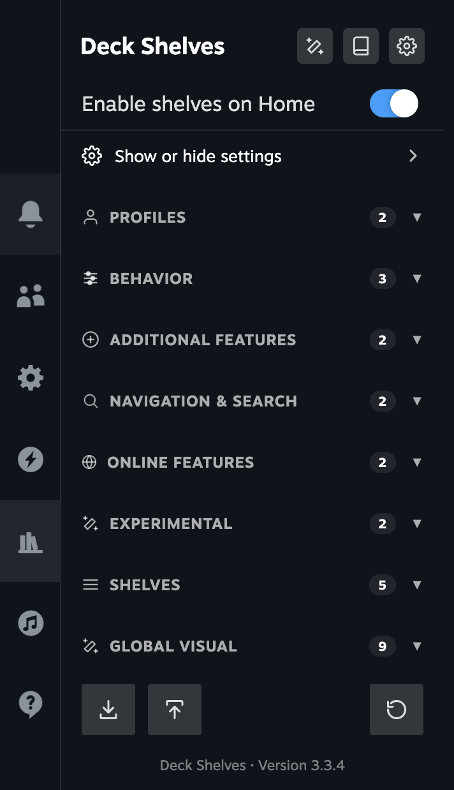
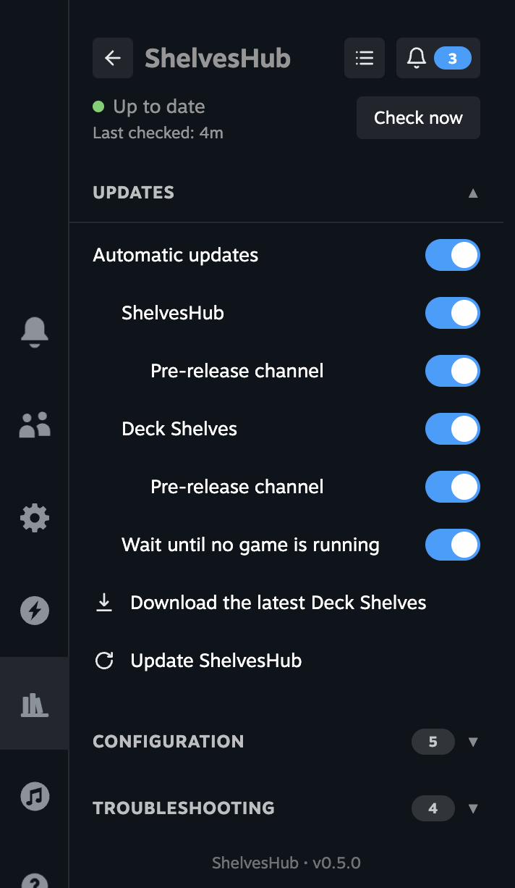
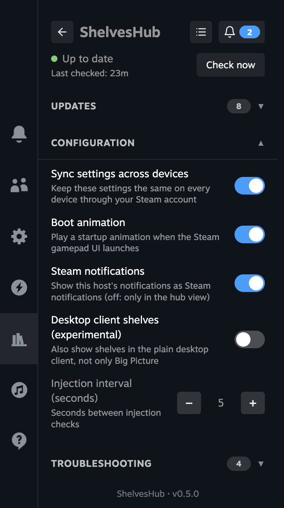
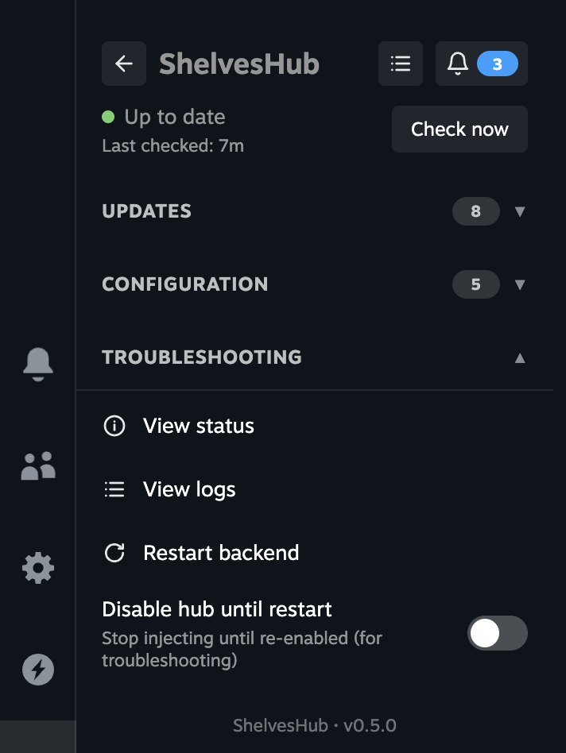
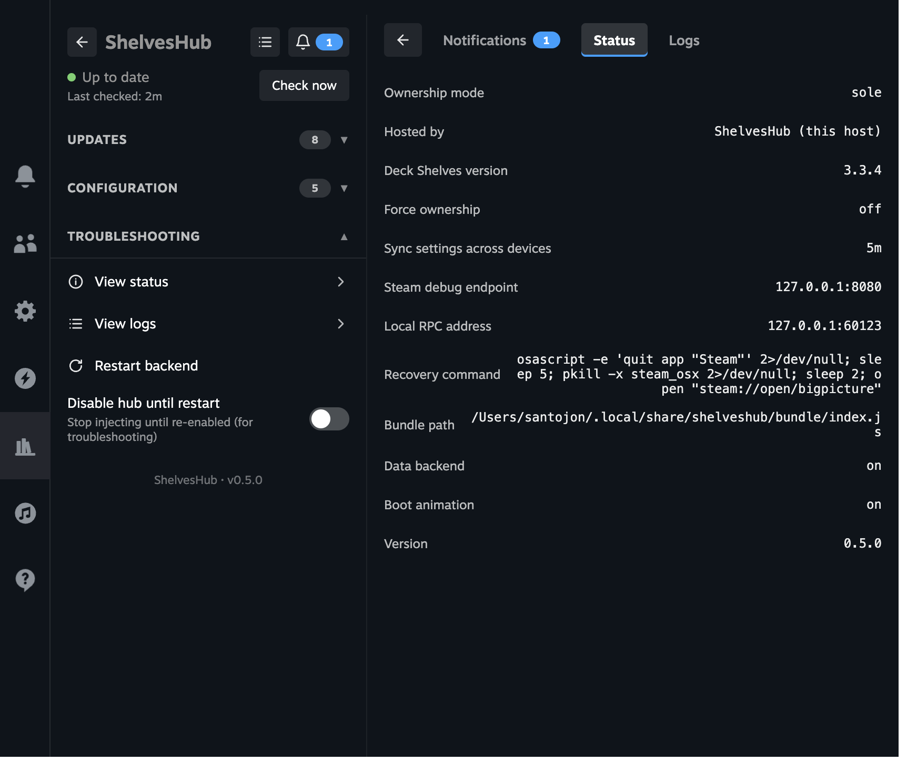
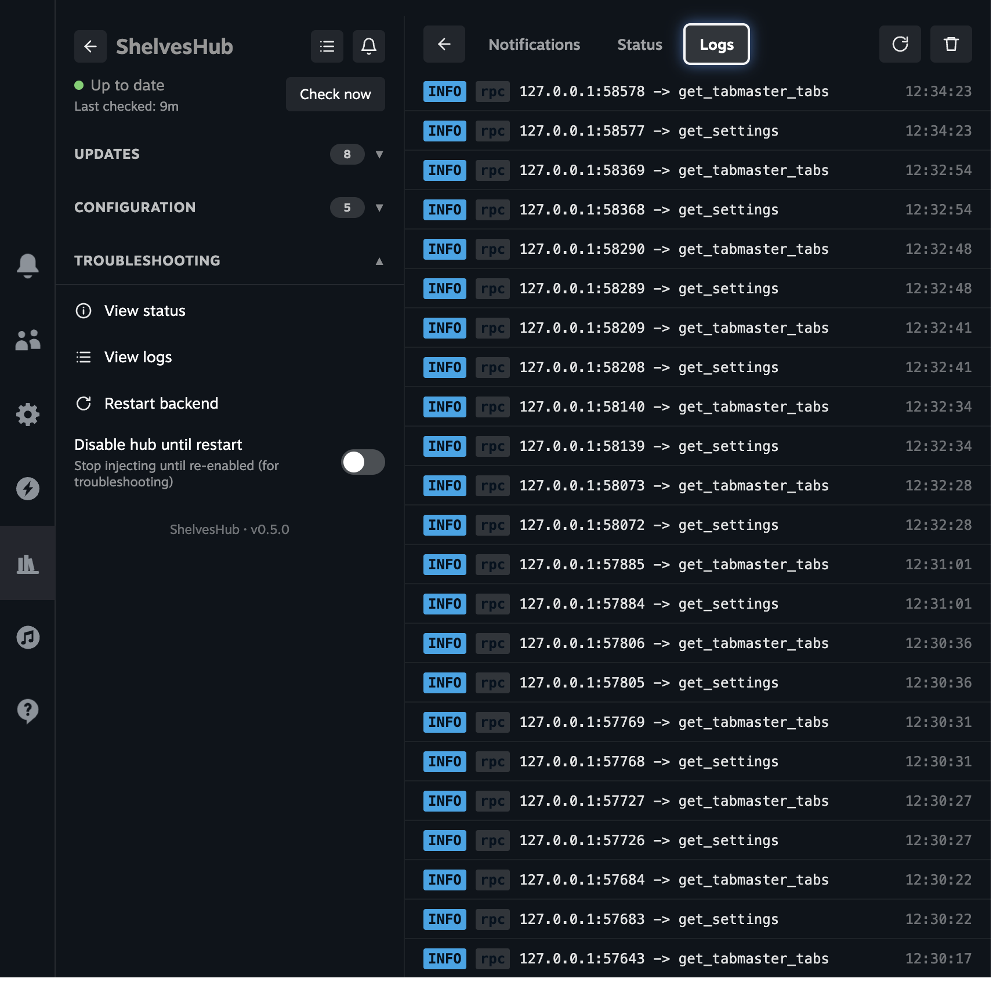
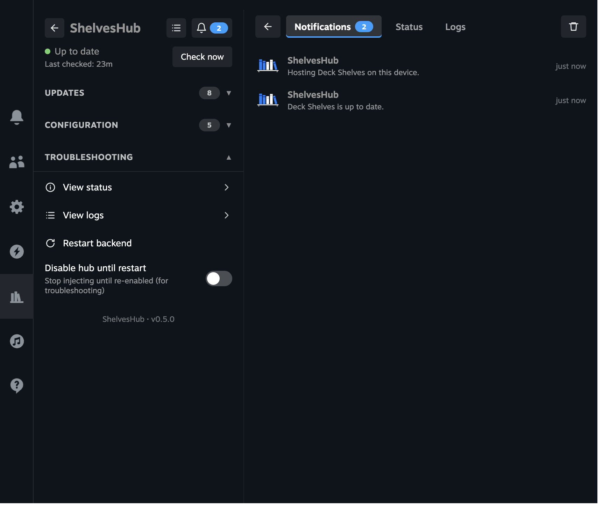
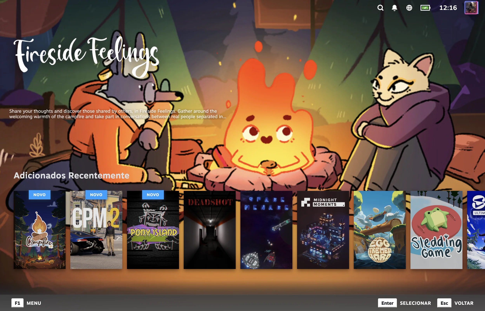
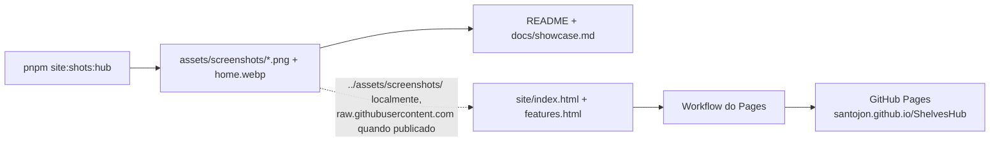
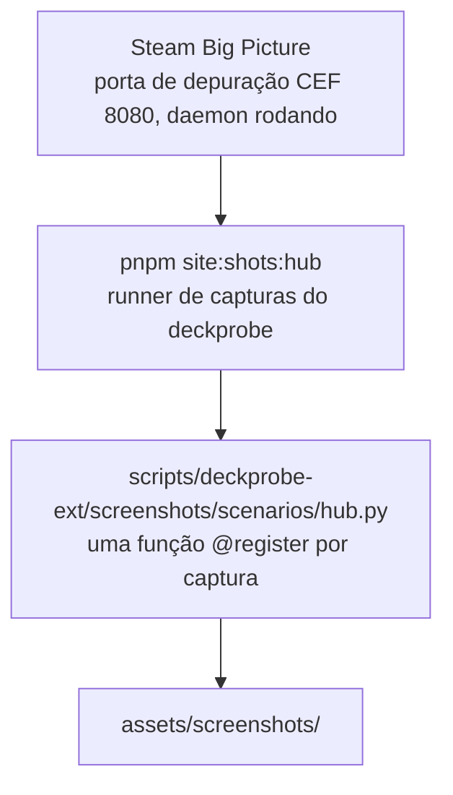

# Vitrine e capturas de tela

*[Read in English](../showcase.md)*

A landing page em [`site/`](../../site/) e o [README](README.md) mostram o mesmo conjunto de
capturas, feitas ao vivo numa sessão do Steam Big Picture num host em que o ShelvesHub roda. Esta
página as incorpora e documenta como são produzidas e publicadas.

## Capturas de tela

| | |
| --- | --- |
|  |  |
| **Aba do Quick Access** — o editor do Deck Shelves, aberto direto. | **Atualizações** — host + Deck Shelves, cada um com canal de pré-lançamento. |
|  |  |
| **Configuração** — o subconjunto seguro editável, cada campo descrito. | **Solução de problemas** — ver estado, ver logs, reiniciar o backend, pausar o host. |
|  |  |
| **Painel lateral — Estado** — modo, quem hospeda, versões, endpoints. | **Painel lateral — Logs** — logs do host + runtime em um único fluxo. |
|  |  |
| **Painel lateral — Notificações** — o que o host te contou, com contador de não lidas. | **Home** — a Home do Deck Shelves, hospedada pelo ShelvesHub. |

## Onde ficam e como o site publica



`assets/screenshots/` é o único lugar canônico. O README e esta página incorporam os arquivos por
caminho relativo; o site não guarda cópias — as páginas tentam primeiro o caminho relativo (uma
prévia local a partir do repositório mostra as imagens na hora) e recorrem a
`raw.githubusercontent.com/…/main/assets/screenshots/` no site publicado, então uma captura nova
chega ao site assim que está na `main`. `.github/workflows/pages.yml` publica `site/` a cada push
na `main` que a toque; `pnpm build:site` regenera, dentro das páginas, as listas bilíngues de
funcionalidades e de versões a partir do README e das notas de versão (EN e pt-BR).

## O conjunto de capturas

| Arquivo | Cenário | Mostra |
|---|---|---|
| `qam-tab.png` | `qam_tab` | A aba nativa do Quick Access com o editor do Deck Shelves |
| `hub-panel.png` | `hub_panel` | A visão do ShelvesHub, Atualizações aberta |
| `hub-config.png` | `hub_config` | A seção Configuração |
| `hub-troubleshooting.png` | `hub_troubleshooting` | A seção Solução de problemas (Ver estado, Ver logs, reiniciar o backend, pausar) |
| `hub-status.png` | `hub_status` | O painel lateral na aba Estado |
| `hub-logs.png` | `hub_logs` | O painel lateral na aba Logs |
| `hub-notifications.png` | `hub_notifications` | O painel lateral na aba Notificações (a central é limpa e duas entradas genéricas enviadas antes, para a captura ficar no idioma da captura; nada é persistido) |
| `home.png` → `home.webp` | `home` | A Home do Deck Shelves, janela inteira; o site serve o WebP (cerca de um décimo do PNG, gravado ao lado quando o Pillow está instalado) |

As visões do hub são recortadas da borda esquerda do documento do menu até o painel
(`[data-fb-panel]`), ou até a borda direita do painel lateral quando ele está aberto (fica à direita
da visão do hub), então as capturas do painel lateral são mais largas. As capturas são em
inglês (`window.__SHELVES_LOCALE__`, `--locale` para trocar), seja qual for o idioma do Steam.

## Capturando



```sh
pnpm site:shots:hub                       # o conjunto inteiro, a partir do Mac local (127.0.0.1:8080)
bash scripts/site/capture-hub-screenshots.sh --only hub_status   # um cenário (o pnpm repassaria o `--`)
DECK_CDP_HOST=192.168.x.x DECK_CDP_PORT=8081 pnpm site:shots:hub   # um Deck pela rede
```

- O daemon precisa estar rodando e o Big Picture aberto; no macOS traga o Steam para a frente
  antes (uma janela coberta pode parar de pintar, e a captura dela volta em branco).
- Cada cenário abre o menu de Acesso Rápido por CDP, chega à aba, abre a visão do ShelvesHub
  (`open-hub`), ajusta as seções recolhíveis, abre o painel lateral quando a captura precisa, e
  captura a partir do documento do QuickAccess; `qam_tab` roda primeiro, com o menu ainda fresco.
- `node scripts/site/capture-screenshots.mjs <nome>` ainda captura a janela inteira do Big
  Picture em `site/img/<nome>.png` para um caso avulso; a galeria não lê essa pasta.

## Prévia de desenvolvimento

Abra `site/index.html` num navegador a partir do repositório (as imagens resolvem por caminho
relativo), ou sirva a raiz do repositório (`python3 -m http.server`) e abra `/site/`. A troca de
idioma guarda a escolha no `localStorage`; as legendas da galeria são traduzidas quando cada
imagem carrega.
