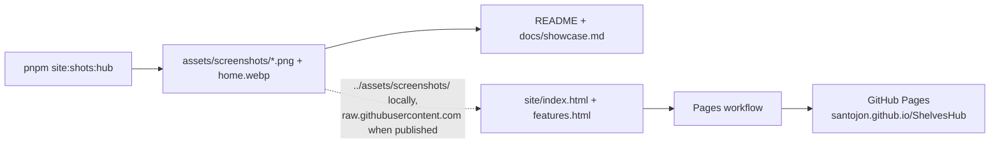
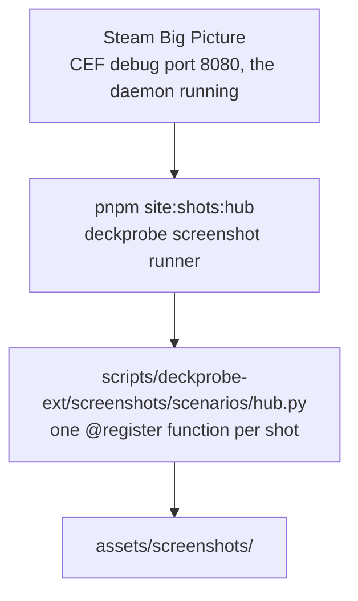

# Showcase & screenshots

*[Leia em português](pt-BR/showcase.md)*

The landing page at [`site/`](../site/) and the [README](../README.md) show the same
screenshot set, captured live from a Steam Big Picture session on a host ShelvesHub runs. This
page embeds them and documents how they are produced and published.

## Screenshots

| | |
| --- | --- |
|  |  |
| **Quick Access tab** — the Deck Shelves editor, opened directly. | **Updates** — host + Deck Shelves, each with a pre-release channel. |
|  |  |
| **Configuration** — the editable safe subset, each field described. | **Troubleshooting** — view status, view logs, restart the backend, pause the host. |
|  |  |
| **Side panel — Status** — mode, who hosts, versions, endpoints. | **Side panel — Logs** — host + runtime logs in one stream. |
|  |  |
| **Side panel — Notifications** — what the host told you, with an unread badge. | **Home** — the Deck Shelves Home, hosted by ShelvesHub. |

## Where they live and how the site publishes



`assets/screenshots/` is the one canonical location. The README and this page embed the files
by relative path; the site keeps no copies — its pages try the relative path first (a local
preview from the repo shows the images straight away) and fall back to
`raw.githubusercontent.com/…/main/assets/screenshots/` on the published site, so a new capture
reaches the site once it is on `main`. `.github/workflows/pages.yml` publishes `site/` on every
push to `main` that touches it; `pnpm build:site` regenerates the bilingual feature and release
lists inside the pages from the README and the release notes (EN and pt-BR).

## The screenshot set

| File | Scenario | Shows |
|---|---|---|
| `qam-tab.png` | `qam_tab` | The native Quick Access tab with the Deck Shelves editor |
| `hub-panel.png` | `hub_panel` | The ShelvesHub view, Updates open |
| `hub-config.png` | `hub_config` | The Configuration section |
| `hub-troubleshooting.png` | `hub_troubleshooting` | The Troubleshooting section (View status, View logs, restart the backend, pause) |
| `hub-status.png` | `hub_status` | The side panel on its Status tab |
| `hub-logs.png` | `hub_logs` | The side panel on its Logs tab |
| `hub-notifications.png` | `hub_notifications` | The side panel on its Notifications tab (the center is cleared and two generic entries posted first, so the shot is in the capture language; nothing is persisted) |
| `home.png` → `home.webp` | `home` | The Deck Shelves Home, full window; the site serves the WebP (about a tenth of the PNG's size, written beside it when Pillow is installed) |

The hub views are clipped from the menu document's left edge to the panel (`[data-fb-panel]`), or
to the side panel's right edge when one is open (it sits to the right of the hub view), so the
side-panel shots are wider. Captures are taken in English
(`window.__SHELVES_LOCALE__` for the hub's strings and the plugin's own `__dsSetLocale` hook for
its panel; `--locale` to change) regardless of Steam's language, and each scenario hands both back
to Steam's language afterwards. A scenario that could not take a fresh capture reports no output
(an older file in `assets/screenshots/` is never counted).

## Capturing



```sh
pnpm site:shots:hub                       # the whole set, from the local Mac (127.0.0.1:8080)
bash scripts/site/capture-hub-screenshots.sh --only hub_status   # one scenario (pnpm would forward the `--`)
DECK_CDP_HOST=192.168.x.x DECK_CDP_PORT=8081 pnpm site:shots:hub   # a Deck over the LAN
```

- The daemon must be running and Big Picture open; on macOS bring Steam to the front first (a
  covered window may stop painting, and a capture of it comes back blank).
- Each scenario opens the Quick Access menu over CDP, reaches the tab, opens the ShelvesHub view
  (`open-hub`), sets the collapsible sections, opens the side panel when the shot needs it, and
  captures from the QuickAccess document; `qam_tab` runs first while the menu is fresh.
- `node scripts/site/capture-screenshots.mjs <name>` still captures the whole Big Picture window
  into `site/img/<name>.png` for a one-off; the gallery does not read that folder.

## Development preview

Open `site/index.html` in a browser from the repository (the images resolve by relative path), or
serve the repository root (`python3 -m http.server`) and open `/site/`. The language switch stores
its choice in `localStorage`; the gallery captions are translated when each image loads.
